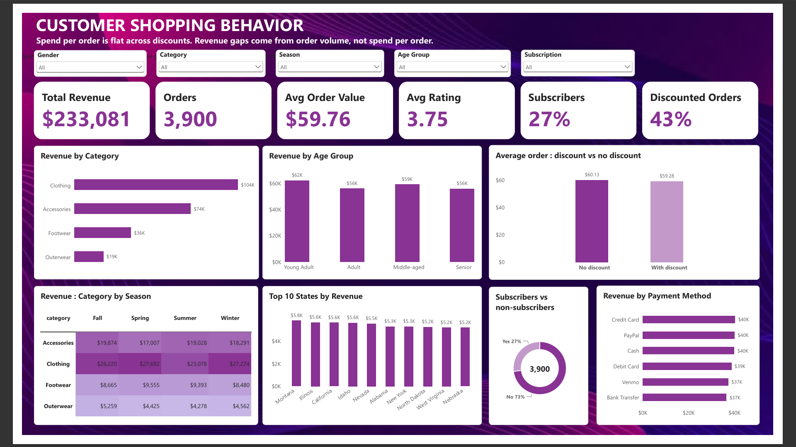

# Customer Shopping Behavior Analysis

End-to-end data analysis of 3,900 retail purchases using Python, MySQL and Power BI, showing that revenue differences come from order volume, not spend per order.



**Business Question:** Do discounts, subscriptions, and shipping options make customers spend more, and where does revenue actually come from?

**Short Answer:** No. Average spend per order is approximately $60 across almost every customer group. Revenue differences between groups are driven primarily by the number of orders, not by differences in average order value.

---

## Dataset

The project uses the public **Customer Shopping Behavior** dataset from Kaggle.

- **Total records:** 3,900 retail purchases
- **Columns:** 18
- **Record structure:** One row per customer purchase

The dataset includes customer demographics, product details, purchase amounts, location, season, review ratings, subscription status, shipping type, discounts, previous purchases, payment methods, and purchase frequency.

---

## Tools & Technologies

| Stage | Tools |
|---|---|
| Data cleaning and exploratory data analysis | Python, pandas, matplotlib, seaborn |
| Data storage and business analysis | MySQL(CTEs, window functions, aggregations) |
| Dashboard | Power BI |
| Development environment | Jupyter Notebook, MySQL Workbench |

---

## Key Findings

### 1. Discounts Don't Increase Average Spend

- **Discounted orders:** $59.28 average purchase amount
- **Non-discounted orders:** $60.13 average purchase amount
- **Orders using discounts:** 43%

Discounted orders have a slightly lower average purchase amount. Based on this dataset, discounts do not appear to increase basket size.

### 2. Subscribers Don't Spend More

- **Subscribers:** $59.49 average purchase amount
- **Non-subscribers:** $59.87 average purchase amount
- **Customers with subscriptions:** 27%

Repeat buyers with more than five previous purchases have a higher subscription rate:

- **Repeat buyers:** 27.6%
- **Other customers:** 22.4%

Subscriptions are more common among repeat buyers, but subscribers do not have a higher average purchase amount.

### 3. Men Generate More Revenue Through Order Volume

| Gender | Total Revenue | Average Purchase Amount | Number of Orders |
|---|---:|---:|---:|
| Male | $157,890 | $59.54 | 2,652 |
| Female | $75,191 | $60.25 | 1,248 |

Male customers generate approximately 68% of total revenue, primarily because they account for more orders. Average purchase amounts are nearly identical across genders.

### 4. Clothing Is the Largest Revenue Category

- **Clothing revenue:** $104,264
- **Share of total revenue:** Approximately 45%
- **Lowest-revenue category:** Outerwear
- **Seasonal pattern:** Outerwear revenue peaks in Fall.

Clothing is the core revenue category and may deserve priority when evaluating product assortment and marketing opportunities.

### 5. Revenue Is Distributed Across States and Age Groups

- **Top state:** Montana, with $5,784 in revenue.
- **Revenue contribution:** Approximately 2.5% of total revenue.
- **Age groups:** Each of the four age groups generates approximately $56,000–$62,000 in revenue.

No single state or age group dominates revenue, suggesting that sales are relatively distributed across these customer segments.

---

## Business Recommendations

1. **Review discount strategy:** Test reducing discount frequency and compare conversion rates, average order value, and profit margins before making broader changes.
2. **Focus on customer acquisition:** Since average purchase amounts are similar across groups, increasing the number of customers and orders may offer greater revenue potential than relying on upselling alone.
3. **Explore growth among women:** Female customers have a similar average purchase amount but account for fewer orders. Test targeted campaigns to understand whether additional acquisition could increase revenue.
4. **Prioritize clothing:** Investigate opportunities to improve product availability, marketing, and seasonal promotions in the highest-revenue category.
5. **Strengthen retention:** Repeat buyers have a higher subscription rate, so evaluate whether subscription programs can improve purchase frequency and long-term customer value.

*Note: These are hypotheses for further testing, not proven causal effects. The dataset does not establish whether discounts, subscriptions, or marketing campaigns cause changes in purchasing behavior.*

---

## Data Cleaning & Preparation (Python)

The data preparation process included:

- Checked for duplicate records and confirmed that `customer_id` is unique.
- Filled 37 missing review ratings (0.9%) using the median rating within the corresponding product category.
- Renamed columns using `snake_case` for consistency.
- Dropped `promo_code_used` because it was identical to `discount_applied` in every row.
- Created an `age_group` column using four equal-sized quartile groups.
- Created a `purchase_frequency_days` column, assuming that "Bi-Weekly" means every 14 days because the dataset does not explicitly define the term.

---

## SQL Business Questions

The project includes 13 SQL analyses:

1. Revenue by gender.
2. Discounted orders that exceed the average purchase amount.
3. Top five products by review rating.
4. Average purchase amount by shipping type (Standard vs. Express).
5. Subscriber vs. non-subscriber spending and revenue.
6. Products with the highest discount rates.
7. Customer segmentation: New, Returning, and Loyal.
8. Top three products in each category using `DENSE_RANK()`.
9. Whether repeat buyers are more likely to subscribe.
10. Revenue by age group.
11. Revenue by category and season.
12. Top 10 states by revenue.
13. Payment method breakdown.

---

## Project Structure

```text
customer_shopping_behavior_analysis/
├── README.md
├── data/
│   ├── raw_data.csv
│   └── full_data.csv
├── notebooks/
│   └── customer_shopping_behavior_analysis.ipynb
├── sql/
│   ├── customer_shopping_behavior_analysis.sql
├── powerbi/
│   └── customer_shopping_behavior_dashboard.pbix
└── images/
    └── dashboard.png
```

## How to Run the Project

### 1. Install Dependencies

```bash
pip install pandas matplotlib seaborn sqlalchemy pymysql
```

### 2. Create the MySQL Database

Open MySQL Workbench and execute:

```sql
CREATE DATABASE customer_behavior;
```

### 3. Configure Database Credentials

Set your MySQL password as an environment variable rather than hardcoding it in the notebook.

For example, on macOS/Linux:

```bash
export MYSQL_PASSWORD="your_password"
```

On Windows PowerShell:

```powershell
$env:MYSQL_PASSWORD="your_password"
```

Configure the notebook to read the password from the environment variable and update the connection settings for your MySQL username and host.

### 4. Run the Jupyter Notebook

Open the notebook in the `notebooks/` directory and run the cells from top to bottom.

The notebook performs data cleaning, exploratory data analysis, and database loading. The final database-loading step creates or populates the cleaned `customer` table in MySQL.

### 5. Execute the SQL Queries

Open the SQL files in `sql/` using MySQL Workbench and execute the queries to explore the business questions.

### 6. Open the Power BI Dashboard

Open the `.pbix` file in Power BI Desktop to explore the dashboard and its visualizations.

Power BI Desktop is available for free on Windows.

---

## Limitations

- The dataset may be synthetic and may not reflect real customer behavior.
- Missing transaction dates limit sales trend analysis.
- The analysis cannot prove that discounts or subscriptions cause changes in spending.
- Missing product costs prevent profitability analysis.
- Findings may not represent real-world retail businesses.

---

## Conclusion

This project demonstrates an end-to-end retail analytics workflow using Python, MySQL, and Power BI.

The analysis suggests that **revenue differences are driven more by purchase volume than by average purchase amount**. Discounts and subscriptions do not show a meaningful increase in average spending in this dataset, while clothing is the largest revenue category.

The next step is to validate these findings with real transaction data, profitability metrics, and controlled experiments before making business decisions.

---

## Skills Demonstrated

- Python (Pandas, Matplotlib, Seaborn)
- SQL (CTEs, Window Functions, Joins)
- Data Cleaning and Exploratory Data Analysis
- MySQL Database Integration
- Power BI Dashboard Development
- Business Insights and Data Visualization
